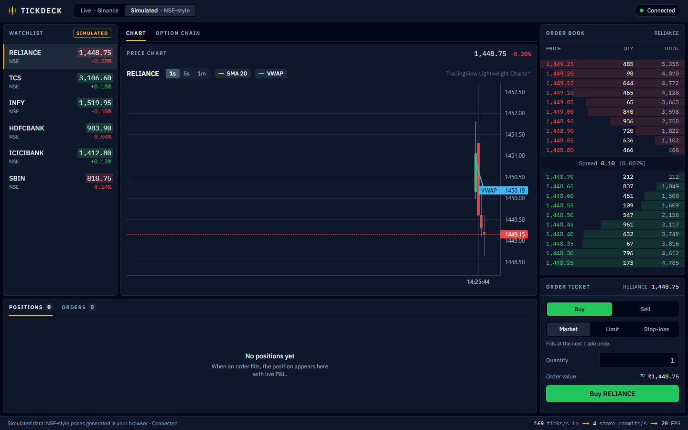

# TickDeck

A real-time trading dashboard built with **Next.js 16 (App Router)**, **strict
TypeScript**, **Zustand 5**, **WebSockets** and TradingView's **Lightweight
Charts 5**. It streams hundreds of trades a second into a watchlist, an order
book, a live candlestick chart and a paper-trading ticket, and keeps the page
smooth by committing market data to the store at most once per animation frame.

**Live demo:** https://tickdeck-kaustubh.netlify.app (live Binance data) and
https://tickdeck-kaustubh.netlify.app/?feed=sim (simulated NSE-style feed).
The demo is a static export (`STATIC_EXPORT=1 npx next build`, which writes
`out/`), since the dashboard runs entirely in the browser.



## Features

- **Two market feeds behind one interface** (`MarketFeed` in `packages/core/src/types.ts`):
  - **Binance**: live trades and top-10 order books for six USDT pairs over
    Binance's public combined WebSocket stream, with type-guarded parsing and
    reconnects with exponential backoff (1 s, 2 s, 4 s, 8 s, then 15 s).
  - **Simulated**: an NSE-style market (RELIANCE, TCS, INFY, HDFCBANK,
    ICICIBANK, SBIN) generated by a random walk in a **Web Worker**, at a
    configurable rate (`?rate=`, default 400 trades/s).
  - **Automatic fallback**: if Binance errors or sends nothing within 5 s, the
    app switches to the simulated feed.
- **Watchlist** with green/red price flashes and full keyboard support
  (WAI-ARIA listbox: arrow keys, Home/End, Enter/Space).
- **Candlestick chart** with 1s / 5s / 1m candles, SMA 20 and VWAP overlays,
  updated incrementally.
- **Order book** ladder with depth bars and the spread.
- **Paper trading**: MARKET, LIMIT and stop-loss (SL) orders, typed as a
  discriminated union, validated by pure functions and filled against the live
  trades. Positions show live P&L.
- **Status bar** that shows the pipeline live: trades in per second, store
  commits per second, and frames painted per second.
- Accessible panels (named landmarks, live regions, visible focus rings) and a
  layout that fits a 1366x650 laptop window and stacks on phones.

## Data flow

```text
 Binance public WebSocket                  Web Worker (sim.worker.ts)
 wss://stream.binance.com:9443/stream      simEngine: random walk on a 25 ms timer
          | JSON text                                | postMessage(FeedMessage[])
          v                                          v
 binanceFeed.ts                            simulatedFeed.ts
 parse + type guards, reconnect/backoff    (runs on the main thread if Workers fail)
          \__________________________________________/
                               |  FeedMessage = tick | book | status
                               v
 FeedProvider.tsx   picks the feed from ?feed=, falls back from Binance to sim,
                    cleans everything up on unmount and on a feed switch
                               |  batcher.push(message), for every message
                               v
 rafBatcher.ts      queues messages and flushes ONCE per requestAnimationFrame
                               |  messages[]: one array per frame
                               v
 marketStore.applyBatch(messages)  ->  ONE set() per frame
 orderStore.onTick(tick)           ->  fills resting orders (set() only on a fill)
                               |
                               v  narrow selector hooks (src/store/selectors.ts)
   WatchlistRow       OrderBook          OrderTicket        PriceChart
   useQuote(symbol)   useBook(selected)  last price only    store.subscribe -> rAF ->
   memo() per row     memo() per level                      series.update() per changed bar
```

## Performance design

1. **rAF batching** (`src/lib/feed/rafBatcher.ts`). Every feed message is
   queued, and the queue is flushed once per animation frame into
   `applyBatch`, which updates the store with a single `set()`. However fast
   trades arrive, React renders at most once per frame. A safety valve flushes
   at 5,000 queued messages, because browsers pause requestAnimationFrame in
   background tabs.
2. **Narrow selectors** (`src/store/selectors.ts`). Components subscribe to the
   smallest value they need, such as `useQuote('TCS')`. `applyBatch` keeps the
   same object for every symbol that did not trade in a frame, so a TCS trade
   re-renders the TCS row and nothing else.
3. **Memoized rows**. Watchlist rows, order-book levels and position rows are
   wrapped in `memo()`, and their callbacks are stable (`useCallback`), so a
   parent re-render does not re-render unchanged rows.
4. **Incremental chart updates** (`src/components/chart/PriceChart.tsx`). The
   chart calls `setData()` only when the symbol or interval changes. After
   that it never re-renders React: it subscribes to the store, folds only the
   new ticks into the candles once per frame and calls `series.update()` for
   the bars that changed.
5. **Off-main-thread simulation**. The simulated market runs in a Web Worker,
   and the throughput counters stay outside React state until they are
   published once a second.

### Measured

Measured with `npm run test:perf -- --headed` (`e2e/perf.spec.ts`): the
production build in a Microsoft Edge 155 window (1280x720) on a Windows 11
laptop with a 240 Hz display, at `?feed=sim&rate=500`. After a 2 s warm-up the
test read the status bar once a second for 10 s. Averages of the 10 samples:

| Metric | Average |
| --- | --- |
| Trades in | **500.2 ticks/s** |
| Store commits | **40.0 commits/s** |
| Frames painted | **224.7 FPS** (display: 240 Hz) |

So about 12.5 trades reach the store per commit, and the page keeps
painting close to the display's refresh rate. The simulator's worker posts its
trades on a 25 ms timer, 40 times a second, which is why commits settle near
40 on a fast display; on a 60 Hz display the batcher would cap them at 60.

First-load JavaScript for `/`, measured with `npm run size` from the
production build (Next.js 16 no longer prints it in `next build`):
**236.4 kB gzip** (759.2 kB raw) in 8 files, plus 6.9 kB gzip of CSS.

## Running it

Requires Node.js 22.

```bash
npm install
npm run dev
```

Then open:

| URL | Feed |
| --- | --- |
| http://localhost:3000/ or `/?feed=binance` | Live Binance data (falls back to simulated if unreachable) |
| http://localhost:3000/?feed=sim | Simulated NSE-style data, 400 trades/s |
| http://localhost:3000/?feed=sim&rate=2000 | Simulated, 2,000 trades/s (at most 10,000) |

Production build: `npm run build`, then `npm start`.

## Tests

| Command | What runs |
| --- | --- |
| `npm run typecheck` | Next.js route types, then `tsc --noEmit` (strict) |
| `npm run lint` | ESLint with the Next.js and TypeScript rules |
| `npm test` | Jest + React Testing Library: **231 tests in 25 suites** |
| `npm run test:e2e` | Playwright: **12 tests**, against the production build on port 3100 |
| `npm run test:perf` | Only the performance measurement (writes `e2e-artifacts/perf.json`) |
| `npm run size` | First-load JS of `/` from the last build |

The Jest suites cover the pure logic (feeds, frame batcher, simulator, candle
aggregation, indicators, order validation and matching, positions), the stores
and the components. The Playwright tests always use `?feed=sim`, so they never
depend on the network. They cover: the page loads and the feed connects;
watchlist prices change within 3 s; selecting a symbol updates the chart; a
LIMIT BUY above the last price fills and appears in Positions; an invalid
quantity shows a validation error; keyboard navigation of the watchlist; the
layout at 1440x900, 1366x650 and phone size; and the performance sample. A
shared fixture fails any test that logs a console error.

Locally, Playwright drives the Microsoft Edge that ships with Windows. CI
(`.github/workflows/ci.yml`, Node 22) runs typecheck, lint, Jest, the build and
the Playwright tests with Playwright's bundled Chromium.

## Project layout

```text
packages/core/     @tickdeck/core: pure TypeScript shared by the web app and the mobile app
                    (no React, no DOM), imported as "@tickdeck/core"
  src/types.ts      the shared contract: Tick, BookSnapshot, FeedMessage, OrderRequest...
  src/symbols.ts    the instruments each feed streams
  src/orders/       validateOrder, matchOrder, position maths
  src/candles/      tick-to-candle aggregation, SMA and VWAP
  src/sim/          simEngine: the simulated NSE market (random walk, order books)
src/
  app/              page.tsx (the grid of panels), layout.tsx, globals.css
  lib/feed/         binanceFeed, simulatedFeed + sim.worker, rafBatcher, createFeed
  store/            marketStore (applyBatch), orderStore (paper trading), selectors
  components/       FeedProvider, chart/, watchlist/, orderbook/, ticket/, positions/, layout/, common/
e2e/                Playwright tests and the performance measurement
scripts/            bundle-size.mjs
```

## Honest notes

- **Simulated data is simulated.** The NSE-style prices are a random walk
  generated in your browser, starting near rough real-world levels. They are
  not quotes, and the stock names are only labels.
- **Orders are paper trades.** Nothing is sent to any broker or exchange. A
  simulated fill happens at the price of the next qualifying trade, with no
  partial fills, queue position, fees or margin.
- **Binance data is public market data** from Binance's public WebSocket
  streams: no API key and no account. Prices are in USDT. The stream may be
  blocked on some networks, in which case TickDeck switches to the simulated
  feed.
- TickDeck is a portfolio project. It is not affiliated with Binance, NSE or
  TradingView. Charts use TradingView's Lightweight Charts library under its
  Apache 2.0 licence, with the attribution link it asks for.
