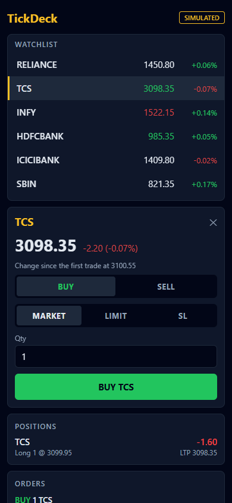

# TickDeck mobile

An Expo (React Native, TypeScript) version of the TickDeck terminal on one
screen: a live watchlist of the simulated NSE stocks, a detail card with an
order ticket (MARKET, LIMIT, SL), positions with unrealised P&L, and orders.

It shares its trading logic with the web app through `@tickdeck/core`
(`../packages/core`): the simulation engine (`runSimulation`), the order rules
(`validateOrder`, `matchOrder`, `applyFill`) and the types. Nothing is copied.

## How it fits together

- `src/state/useTerminal.ts` starts the shared simulation on `setInterval` and
  pushes its trades into a batcher (`src/market/batcher.ts`), which hands them
  to the reducer at most once every 100 ms, so about 10 UI updates a second.
- `src/state/terminal.ts` is a pure reducer: quotes, orders and positions. It
  applies each trade in order with the shared `matchOrder` and `applyFill`.
- `src/components/OrderTicket.tsx` validates while the user types with the
  same `validateOrder` as the web ticket.

`@tickdeck/core` resolves through three matching entries:
`tsconfig.json` `paths` (TypeScript), `metro.config.js` `resolveRequest` and
`watchFolders` (the bundler), and `jest.config.js` `moduleNameMapper` (tests).

## Commands

Run these inside `mobile/`. The app has its own `package.json` and
`node_modules`; nothing is installed at the repository root.

```bash
npm install
npm start            # Expo dev server (Expo Go, Android emulator or web)
npm run typecheck    # tsc --noEmit
npm test             # Jest (jest-expo)
npm run export:web   # static web build in dist-web/
```



## What is verified

`npm ci`, `npm run typecheck`, `npm test` (16 tests in 3 suites) and
`npm run export:web` pass. The screen was checked through the web export in
Microsoft Edge at 390x844 (the screenshot above). The app has not yet been run
on an Android or iOS device or emulator, and the tests cover the pure logic
(batcher, reducer, ticket form), not the components.
